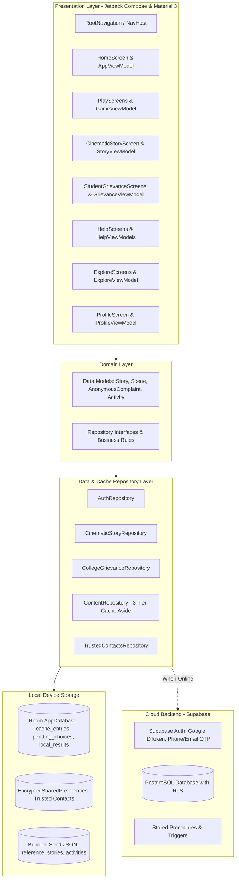

# Drug-Free India

**An Android-based social-impact initiative using interactive storytelling, scenario-based learning, and accessible digital experiences to promote drug-free living.**

*Also branded as **VILZO** (Vibrant India Zero Overdose) · Package: `com.drugfreeindia.app`*

---

## Table of Contents

- [1. Executive Summary & Problem Positioning](#1-executive-summary--problem-positioning)
- [2. Project Context: VBYLD 2027 — Hack for Social Cause](#2-project-context-vbyld-2027--hack-for-social-cause)
- [3. Implementation Inventory](#3-implementation-inventory)
- [4. Complete Feature Documentation](#4-complete-feature-documentation)
  - [A. User Onboarding & Authentication](#a-user-onboarding--authentication)
  - [B. Scenario Games (7 Simulations)](#b-scenario-games-7-simulations)
  - [C. Cinematic Story Mode ("The Changes Nobody Noticed")](#c-cinematic-story-mode-the-changes-nobody-noticed)
  - [D. Zero-Knowledge Anonymous Student Grievance & Incident Reporting](#d-zero-knowledge-anonymous-student-grievance--incident-reporting)
  - [E. Explore & Positive Substitution](#e-explore--positive-substitution)
  - [F. Verified Help & Support Directory](#f-verified-help--support-directory)
  - [G. Impact Tracking & Community View](#g-impact-tracking--community-view)
  - [H. User Profile, Accessibility & Data Privacy](#h-user-profile-accessibility--data-privacy)
  - [I. Companion Module: College Staff Administration Portal](#i-companion-module-college-staff-administration-portal)
- [5. Visual Documentation & Screenshots](#5-visual-documentation--screenshots)
- [6. Technology Stack](#6-technology-stack)
- [7. System Architecture](#7-system-architecture)
- [8. Repository Structure](#8-repository-structure)
- [9. How to Use the Application (End-User Guide)](#9-how-to-use-the-application-end-user-guide)
- [10. Development Setup & Build Instructions](#10-development-setup--build-instructions)
- [11. Google Sign-In & Authentication Configuration](#11-google-sign-in--authentication-configuration)
- [12. Backend Architecture, Supabase & Database Schema](#12-backend-architecture-supabase--database-schema)
- [13. Privacy, Security & Ethical Design](#13-privacy-security--ethical-design)
- [14. Social Impact & Innovation Framework](#14-social-impact--innovation-framework)
- [15. Current Limitations & Future Roadmap](#15-current-limitations--future-roadmap)
- [16. Verification, Testing & Quality Assurance](#16-verification-testing--quality-assurance)
- [17. License, Credits & Disclaimer](#17-license-credits--disclaimer)

---

## 1. Executive Summary & Problem Positioning

### The Challenge
Substance use among adolescents and college students remains a pressing public health concern across India. Conventional anti-substance interventions often rely on fear-based messaging, one-way lectures, or abstract legal penalties. Research and field observations consistently indicate that:
- **Moralising messages create silence:** Fear-driven campaigns often inadvertently stigmatise experimentation, preventing young people from seeking early help or talking to peers when early red flags appear.
- **Peer pressure occurs in nuanced, everyday situations:** Pressure rarely resembles dramatic cinematic confrontations; it happens during late-night hostel study sessions, WhatsApp group dares, inter-college tournament celebrations, family functions, and moments of acute academic stress.
- **Refusal is a behavioural skill:** Saying "no" without escalating social friction is an actionable communication skill that requires cognitive rehearsal. Without practice, instinctive reflexes like blending in often take over.
- **Support pathways are fragmented:** Students facing stress or early dependence often do not know where to turn, fear institutional punishment, or lack access to verified, private counselling resources.

### The Drug-Free India (VILZO) Approach
Rather than lecturing, **Drug-Free India** provides a calm, youth-friendly, non-judgmental digital environment that treats users with dignity:
1. **Interactive Cognitive Rehearsal:** Users navigate micro-scenarios where they practice setting firm, respectful boundaries, choosing alternative activities, or executing safe exit strategies.
2. **Immersive Branching Narratives:** A dedicated Story Mode follows relatable student characters through multi-week arcs, illustrating how early isolation unfolds and how reaching out to professional support can alter trajectories.
3. **Zero-Knowledge Campus Protection:** An anonymous student grievance channel empowers students to report campus hotspots or request assistance without fear of disciplinary exposure.
4. **Positive Substitution:** An "Explore" module directs youth energy toward wholesome campus life—sports, volunteering, hackathons, open-source initiatives, and cultural events.
5. **Dignified, Private Support:** Direct integration with national 24/7 helplines (Tele-MANAS 14416, ERSS 112, MANAS 1933) and local de-addiction centres, alongside device-encrypted emergency contacts.

> [!NOTE]  
> **Health & Ethical Disclaimer:** Drug-Free India is an educational awareness, resilience-building, and referral platform. It is **not** a diagnostic device, clinical treatment system, or substitute for licensed medical or psychological care.

---

## 2. Project Context: VBYLD 2027 — Hack for Social Cause

| Field | Description / Verified Information |
|---|---|
| **Challenge Name** | MY Bharat · VBYLD 2027 (Viksit Bharat Young Leaders Dialogue / Youth Tech Challenge) |
| **Track** | Hack for Social Cause |
| **Project Title** | Drug-Free India (VILZO: Vibrant India Zero Overdose) |
| **Target Beneficiaries** | Higher-education students, adolescent youth, campus counsellors, youth-club volunteers, academic institutions |
| **Core Innovation** | Gamified refusal simulation, branching cinematic empathy storytelling, offline-first privacy architecture, and zero-knowledge campus incident reporting |
| **Primary Platforms** | Native Android (Client App: `app`, Companion Staff App: `college_staff_app`) |
| **Team Details** | `[Add verified team details]` |
| **Institution** | `[Add verified institution details]` |
| **Submission Category** | Social Impact & Healthcare Technology / Student Wellbeing |

*Note: This repository represents an independent social-impact technical solution prepared for challenge evaluation. It is not an official government-administered application.*

---

## 3. Implementation Inventory

To maintain complete engineering transparency, all system capabilities have been verified against the active codebase:

| Module / Feature | Status | Implementation Details in Repository |
|---|---|---|
| **Onboarding & Setup Flow** | **Fully Implemented** | `WelcomeScreen.kt`, `VilzoSplashAnimationScreen.kt`, `LocationScreen.kt` |
| **Authentication (Google ID Token)** | **Fully Implemented** | `AuthRepository.kt` via Android Credential Manager + Supabase Auth |
| **Authentication (Email / Mobile OTP)** | **Fully Implemented** | Supabase OTP with local development fallback (`123456`) in `AuthRepository.kt` |
| **Guest Access Mode** | **Fully Implemented** | Full offline exploration without cloud authentication requirement |
| **Scenario Games (7 Simulations)** | **Fully Implemented** | `PlayScreens.kt`, `PlayViewModels.kt`, `seed/stories.json`, Room cache |
| **Cinematic Story Mode** | **Fully Implemented** | `CinematicStoryScreen.kt`, `CinematicStoryRepository.kt`, `the_changes_nobody_noticed.json` (14 scenes, 3 endings) |
| **Zero-Knowledge Anonymous Chat** | **Fully Implemented** | `StudentGrievanceScreens.kt`, `CollegeGrievanceRepository.kt`, `08_anonymous_complaints.sql` |
| **Explore & Healthy Activities** | **Fully Implemented** | `ExploreScreens.kt`, `ExploreImpactRepositories.kt`, `seed/activities.json` |
| **Help & Support Directory** | **Fully Implemented** | `HelpScreens.kt`, `CentresMap.kt` (Google Maps + OpenStreetMap fallback) |
| **Verified Helplines (112, 14416, etc.)** | **Fully Implemented** | `seed/reference.json`, `HelplinesScreen.kt` |
| **Trusted Emergency Contacts** | **Fully Implemented** | `TrustedContactsRepository.kt` with device-side `EncryptedSharedPreferences` |
| **Quick Exit Safety Feature** | **Fully Implemented** | `HelpScreens.kt` (immediate screen clearing to neutral utility screen) |
| **Offline-First Architecture** | **Fully Implemented** | Room DB (`cache_entries`, `pending_choices`, `local_results`) in `AppDatabase.kt` |
| **Multilingual Localization** | **Fully Implemented** | 8 Indian languages (English, Hindi, Tamil, Telugu, Kannada, Malayalam, Marathi, Bengali) |
| **Companion College Staff App** | **Fully Implemented** | Sub-project `college_staff_app` for institutional review of anonymous reports |
| **Multiplayer / P2P Challenges** | *Planned* | Documented in badge schema (`team_player`), targeted for future releases |
| **Automated Voiceover Narration** | *Planned* | TTS hook ready; recorded studio audio planned for future iterations |

---

## 4. Complete Feature Documentation

### A. User Onboarding & Authentication
The onboarding experience is designed with zero friction, ensuring immediate utility even without network connectivity.

- **Splash Animation:** High-performance hardware-accelerated animated startup screen featuring the VILZO emblem (`VilzoSplashAnimationScreen.kt`).
- **Welcome Walkthrough:** Three key value propositions—everyday confidence, interactive zero-judgment learning, and confidential support.
- **Sign-In Options:**
  1. **Google Sign-In:** Utilises Android Credential Manager (`androidx.credentials`) to obtain a cryptographically secure Google ID Token, passed to Supabase Auth (`IDToken` provider).
  2. **Mobile / Email OTP:** Direct passwordless authentication. For development and offline testing, a local test bypass (`123456`) allows full feature access without exhausting SMS gateways.
  3. **Continue as Guest:** Users can immediately use the app with no account creation. All progress is preserved locally via Room and `EncryptedSharedPreferences`.
- **Personalisation:** Optional display nickname (e.g., "Calm Falcon"), optional college code affiliation (e.g., `PUDU-NIT`, `IITM-CHE`), and language selection.

### B. Scenario Games (7 Simulations)
Users practice critical decision-making through rapid, bite-sized scenarios located in `app/src/main/assets/seed/stories.json`. Each scenario models realistic peer pressure, measures a dynamic pressure meter, enforces an optional decision timer (20 seconds), and provides constructive educational feedback:

```
Play Screen → Select Scenario → Scene Narration & Peer Quote → Choose Action → Review Educational Feedback & Badges
```

| ID | Exact Title | Domain Pack | Realistic Scenario Description | Primary Learning Objective |
|---|---|---|---|---|
| `farewell_party` | **The Farewell Party** | Campus | Terrace celebration where peers push Arjun to try an unknown substance. | Practise confident verbal refusal (`calm_no`), redirection, and graceful exit plans. |
| `group_chat_dare` | **Group Chat Dare** | Online | A late-night dare circulating in the college batch WhatsApp group. | Setting digital boundaries, refusing to be an audience, and offering private peer support. |
| `hostel_night` | **Hostel Night** | Hostel | 1:30 AM before final exams; roommate offers a chemical shortcut to stay awake. | Sticking to personal study routines, recognizing panic, and offering collaborative revision. |
| `after_the_match` | **After the Match** | Sports | High-energy sports celebration where teammates pressure members to drink heavily. | Celebrating victories authentically without compromising personal standards or team bonds. |
| `cousins_wedding` | **Cousin's Wedding** | Family | Older relatives at a family celebration pressure the user to drink behind the tent. | Handling familial pressure respectfully, using real responsibilities, and mentoring younger cousins. |
| `the_cool_senior` | **The Cool Senior** | Campus | An admired project lead sets substance use as an informal condition for joining the core team. | Setting professional workplace boundaries and letting technical merit speak for itself. |
| `stressed_before_exams` | **Stressed Before Exams** | Exams | High anxiety 10 minutes prior to a difficult exam; peer offers an unverified calming pill. | Practising somatic grounding (deep breathing, hydration) and rejecting unknown substances. |

### C. Cinematic Story Mode ("The Changes Nobody Noticed")
A multi-chapter interactive branching narrative (`the_changes_nobody_noticed.json`) that explores the gradual, subtle onset of substance-induced isolation and academic disengagement:

- **Characters:**
  - *Arjun:* 20-year-old third-year Computer Science student building a bus-tracking application with Team Nimbus.
  - *Karthik:* Arjun's close friend and teammate who senses changes before others speak up.
  - *Meera:* The blunt, fair, and supportive lead of Team Nimbus.
  - *Amma:* Arjun's mother, calling with care while struggling to understand his withdrawal.
  - *Dr. Nandhini:* Wellness centre counsellor offering compassionate, non-punitive options.
- **Narrative Graph:** 17 total nodes consisting of 14 branching decision scenes (`S01` to `S14`) and 3 terminal endings verified by automated graph tests (`CinematicStoryGraphTest.kt`):
  1. **Ending E01: The Distance Grows (Unresolved):** Arjun isolates himself, leaving messages unaddressed. Illustrates that while avoiding tough conversations feels like temporary relief, problems compound in silence.
  2. **Ending E02: Not There Yet (Uncertain):** Arjun acknowledges his struggle and keeps his appointment card, supported by Karthik's patience ("No timer on this, da. Whenever you're ready, I'm here."). Reassures users that seeking help often takes multiple attempts.
  3. **Ending E03: A Different Beginning (Supported):** Three weeks later, Arjun rejoins his project team and continues counselling at the campus wellness centre, embracing the reality that progress takes time.

### D. Zero-Knowledge Anonymous Student Grievance & Incident Reporting
To resolve the widespread fear of academic punishment or peer retaliation, the application introduces a privacy-first incident reporting system:
- **Zero-Knowledge Tokenization:** Each student instance generates an isolated cryptographic client pseudonym (`anon_client_token_<uuid>`).
- **Two-Way Anonymous Messaging:** Students can report drug distribution on campus, unsafe hostel environments, or personal distress, and receive direct replies from authorised college nodal staff.
- **Campus Affiliation:** Reports are routed strictly to the designated institution's security or wellness committee without transmitting name, email, student ID, or device hardware identifiers.

### E. Explore & Positive Substitution
Preventing substance use requires offering attractive, pro-social alternatives. The Explore tab provides verified listings across:
- **Hackathons & Technical Events:** Smart India Hackathon (SIH), IEEE Hackverse, FOSS Pondicherry, MY Bharat VBYLD Hackathon.
- **Community Volunteering:** Robin Hood Army food drives, Auroville AVAG rural initiatives, Sadhana Forest reforestation.
- **Sports & Fitness:** Khelo India campus youth challenges, Auroville International Marathon.
- **Arts & Culture:** Serendipity Arts Festival, Madras Music Season, Mamallapuram Dance Festival.

### F. Verified Help & Support Directory
Immediate access to vetted support infrastructure:
- **National Helplines:**
  - `112`: Emergency Response Support System (ERSS) — 24/7 Police, Fire, Ambulance.
  - `14416`: Tele-MANAS — 24/7 Free Mental Health Counselling.
  - `1933`: MANAS National Substance-Dependence Toll-Free Helpline.
  - `14446`: Ministry of Social Justice and Empowerment (MSJE) De-Addiction Helpline.
- **Centre Finder:** Interactive dual-engine mapping interface (`CentresMap.kt`) supporting Google Maps Compose and an open-source OpenStreetMap (`osmdroid`) fallback. Calculates Haversine distance from the user's nearest city.
- **Trusted Contacts:** Up to 5 private emergency contacts stored strictly on-device in `EncryptedSharedPreferences` backed by the Android Keystore.
- **Quick Exit Feature:** A prominent red safety button located at the top-right of the Help screen that instantly navigates away from sensitive content to a neutral, innocuous screen.

### G. Impact Tracking & Community View
- **Monthly Pulse Survey:** 100% anonymous check-ins measuring changes in self-reported refusal confidence and campus safety perceptions.
- **Anonymised Aggregation:** Submissions are stripped of user IDs and exact timestamps, grouping data into monthly buckets.
- **Institutional Views:** Aggregates are displayed only when a campus cohort exceeds the minimum privacy threshold (`min_cohort = 10`).

### H. User Profile, Accessibility & Data Privacy
- **Language Switcher:** Seamless switching across 8 Indian languages (Hindi, Tamil, Telugu, Kannada, Malayalam, Marathi, Bengali, English).
- **Reduced Motion Support:** Accessible Compose UI transitions respecting user vestibular preferences.
- **Local Data Wipeout:** "Delete All Stored Data" button that executes a complete purge of Room caches, encrypted preferences, and local game records.

### I. Companion Module: College Staff Administration Portal
Located in `college_staff_app/` (`rootProject.name = "VilzoCollegeStaff"`), this companion application provides authorized university nodal officers with:
- Secure institutional sign-in.
- Triage dashboard for anonymous student complaints (filter by Pending, In Progress, Resolved).
- Direct bidirectional anonymous chat responses to student inquiries.

---

## 5. Visual Documentation & Screenshots

The repository includes high-fidelity screenshots capturing the application's user journey under `docs/screenshots/`:

| Screen Name | File Path | Preview Description |
|---|---|---|
| **Welcome Screen** | [`docs/screenshots/screen_welcome.png`](docs/screenshots/screen_welcome.png) | High-impact illustrated onboarding introducing the mission and core pillars. |
| **Authentication Screen** | [`docs/screenshots/screen_auth.png`](docs/screenshots/screen_auth.png) | Unified login showing Google Sign-In, Mobile/Email OTP, and Guest access. |
| **Home Dashboard** | [`docs/screenshots/01_home_screen.png`](docs/screenshots/01_home_screen.png) | Weekly Refusal Challenge card, day streak counter, badges, and quick help actions. |
| **Scenario Simulation** | [`docs/screenshots/02_play_scenario.png`](docs/screenshots/02_play_scenario.png) | Scenario playback interface with peer dialogue, pressure meter, and decision options. |
| **Scenario Outcome** | [`docs/screenshots/03_play_result.png`](docs/screenshots/03_play_result.png) | Educational feedback explaining why specific responses work and awarding badges. |
| **Help & Support Hub** | [`docs/screenshots/04_help_main.png`](docs/screenshots/04_help_main.png) | Emergency call action, verified national helpline list, and anonymous grievance trigger. |
| **Rehabilitation Centres** | [`docs/screenshots/04_help_centres.png`](docs/screenshots/04_help_centres.png) | Interactive map view locating nearby government de-addiction facilities and hospitals. |
| **Quick Exit Safety** | [`docs/screenshots/05_quick_exit.png`](docs/screenshots/05_quick_exit.png) | Neutral utility screen triggered instantly to protect user confidentiality. |
| **Explore & Opportunities**| [`docs/screenshots/06_explore.png`](docs/screenshots/06_explore.png) | Filterable feed of hackathons, cultural festivals, sports events, and volunteer clubs. |
| **Impact & Community Survey**| [`docs/screenshots/07_survey_impact.png`](docs/screenshots/07_survey_impact.png) | Monthly anonymous pulse survey capturing aggregate student wellbeing metrics. |
| **Profile & Settings** | [`docs/screenshots/08_profile_screen.png`](docs/screenshots/08_profile_screen.png) | Language selection, accessibility controls, and complete data wipe option. |

---

## 6. Technology Stack

Verified from `gradle/libs.versions.toml` and module build scripts:

| Layer | Technology | Version | Purpose |
|---|---|---|---|
| **Platform** | Android OS | SDK 26 to 35 | Target Android 15 (Vanilla Ice Cream) with broad backwards compatibility |
| **Language** | Kotlin | `2.0.21` | Modern, type-safe application logic and coroutines |
| **UI Framework** | Jetpack Compose & Material 3 | BOM `2024.11.00` | Declarative, accessible, responsive design system |
| **Architecture** | Clean Architecture + Unidirectional Data Flow | Hilt `2.51.1` | Decoupled presentation, domain, and data layers |
| **Local Database** | Android Room | `2.6.1` | Local SQLite caching, offline queueing, and result persistence |
| **Secure Storage** | AndroidX Security Crypto | `1.1.0-alpha06` | Android Keystore-backed `EncryptedSharedPreferences` for private contacts |
| **Cloud Backend** | Supabase Kotlin SDK | `3.1.4` | Authentication, PostgreSQL database, PostgREST API, and Storage |
| **Networking** | Ktor Client OkHttp | `3.1.1` | Resilient HTTP transport for Supabase SDK |
| **Authentication** | AndroidX Credential Manager | `1.3.0` | Native Google ID-Token authentication (`googleid 1.1.1`) |
| **Image Loading** | Coil Compose | `2.7.0` | Asynchronous WebP/vector image rendering |
| **Mapping Engine** | Google Maps Compose & osmdroid | `6.2.1` / `6.1.20` | Dual-engine geographical centre finder with offline fallback |
| **Build System** | Android Gradle Plugin (AGP) | `8.7.3` | Multi-module build automation, ProGuard/R8 optimization |
| **Unit Testing** | JUnit 4, MockK, Turbine | `4.13.2` / `1.13.13` | Automated unit testing and reactive Flow verification |

---

## 7. System Architecture

Drug-Free India follows Clean Architecture principles with an **Offline-First single source of truth** pattern:



### 3-Tier Data Fetching Strategy:
1. **Tier 1 (Remote Supabase):** When network connectivity is active and credentials are present, fresh data is fetched via PostgREST.
2. **Tier 2 (Room Database Cache):** Responses are automatically mirrored into the local SQLite database as JSON DTOs.
3. **Tier 3 (Bundled Seed Assets):** If the device is entirely offline or unauthenticated, the app loads verified assets from `assets/seed/`, guaranteeing zero startup crashes.

---

## 8. Repository Structure

```
DFS/
├── .gitignore                               # Version control ignore rules (scrubs apks, local.properties)
├── build.gradle.kts                         # Root Gradle configuration
├── settings.gradle.kts                      # Module settings (DrugFreeIndia, :app)
├── gradle.properties                        # JVM memory and build optimization flags
├── local.defaults.properties                # Committed environment template with safe placeholders
├── local.properties.example                 # Clear developer setup guide with explanatory comments
├── app/                                     # Primary Android Application Module
│   ├── build.gradle.kts                     # App dependencies, BuildConfig fields, ProGuard rules
│   ├── src/
│   │   ├── main/
│   │   │   ├── AndroidManifest.xml          # Permissions, activities, deep link intent filters
│   │   │   ├── assets/
│   │   │   │   ├── help_a_friend.md         # Educational guide for supporting peers responsibly
│   │   │   │   └── seed/                    # Bundled offline-first JSON seed records
│   │   │   │       ├── activities.json      # Curated extracurriculars and hackathons
│   │   │   │       ├── reference.json       # Cities, colleges, helplines, centres, badges
│   │   │   │       ├── stories.json         # 7 interactive scenario simulations
│   │   │   │       └── the_changes_nobody_noticed.json # 17-node cinematic story graph
│   │   │   ├── java/com/drugfreeindia/app/
│   │   │   │   ├── DfiApplication.kt        # Hilt Application entry point
│   │   │   │   ├── MainActivity.kt          # Single-activity architecture & deep link routing
│   │   │   │   ├── data/
│   │   │   │   │   ├── local/               # Room database (AppDatabase, DAOs, Entities)
│   │   │   │   │   ├── remote/              # Supabase Client Module, Error Mappers
│   │   │   │   │   ├── repository/          # Repositories (Auth, Content, Grievance, Story, etc.)
│   │   │   │   │   └── secure/              # Android Keystore & EncryptedSharedPreferences
│   │   │   │   ├── di/                      # Hilt dependency injection bindings
│   │   │   │   ├── domain/model/            # Kotlin Data Models & DTOs
│   │   │   │   └── presentation/            # Jetpack Compose UI Screens & ViewModels
│   │   │   │       ├── admin/               # In-app administration triage views
│   │   │   │       ├── components/          # Design system components, buttons, bottom navigation
│   │   │   │       ├── explore/             # Healthy alternative activity discovery
│   │   │   │       ├── help/                # Helplines, maps, trusted contacts, grievance UI
│   │   │   │       ├── home/                # Main dashboard, streak counter, action shortcuts
│   │   │   │       ├── impact/              # Community view, pulse surveys, analytics
│   │   │   │       ├── navigation/          # Navigation graph, destinations, AppViewModel
│   │   │   │       ├── onboarding/          # Splash animation, welcome carousel, auth screen
│   │   │   │       ├── play/                # Scenario game engine & Cinematic Story viewer
│   │   │   │       ├── profile/             # Profile management, language toggle, data wipe
│   │   │   │       └── theme/               # Material 3 colors, typography, elevations, shapes
│   │   │   └── res/                         # Android drawables, mipmaps, and 8 localized strings.xml
│   │   └── test/java/com/drugfreeindia/app/ # Unit tests (CinematicStoryGraphTest, PlayScoringTest)
├── college_staff_app/                       # Companion Android application for college nodal staff
├── docs/                                    # Documentation assets, image prompt guides, screenshots
├── supabase/                                # SQL migrations, Row-Level Security policies, and seeds
│   ├── 01_schema.sql                        # Core table definitions, enums, and triggers
│   ├── 02_rls_policies.sql                  # Row-Level Security isolation rules
│   ├── 03_functions.sql                     # Stored procedures (anonymous submissions, aggregations)
│   ├── 04_seed.sql                          # Production seed dataset (verified centres, colleges)
│   ├── 07_real_explore_listings.sql         # Real Indian events, hackathons, and volunteer drives
│   ├── 08_anonymous_complaints.sql          # Zero-knowledge student grievance tables & policies
│   └── 99_release_checks.sql                # Verification queries and schema sanity checks
└── tools/                                   # Python automation utilities for asset generation
```

---

## 9. How to Use the Application (End-User Guide)

### Step 1: Launch and Personalisation
1. Launch the application to view the animated VILZO emblem.
2. Read through the 3-step introductory walkthrough explaining refusal skills and confidentiality.
3. Tap **Get Started** to authenticate via Google, enter your mobile/email for OTP verification, or select **Continue as Guest** for instant access.
4. Set an optional anonymous nickname and select your preferred regional language.

### Step 2: Practising Refusal Skills (Scenario Games)
1. Navigate to the **Play** tab on the bottom bar.
2. Tap on any of the 7 scenario challenges (e.g., *The Farewell Party* or *Hostel Night*).
3. Read the contextual scenario and peer quote.
4. Select one of the available choices before the 20-second timer expires.
5. Review the educational breakdown explaining why the choice succeeds and view your earned badges.

### Step 3: Immersive Cinematic Story Mode
1. In the **Play** tab, tap **Explore Stories** to enter the Story Library.
2. Launch **The Changes Nobody Noticed**.
3. Follow Arjun’s journey through dialogue, thoughts, and team group chats.
4. Make decisions at pivotal narrative forks to navigate toward one of the 3 realistic endings.
5. Reflect on the story’s closing insights and discover practical next steps.

### Step 4: Submitting an Anonymous Grievance or Seeking Chat Support
1. Tap the **Chat** tab or select **Anonymous Grievance** under the **Help** tab.
2. Choose a category: *Substance Incident*, *Campus Hotspot*, or *Mental Health Support*.
3. Select your college and type your detailed message.
4. Submit the report. An isolated anonymous client token ensures you can return and read administrative replies without revealing your identity.

### Step 5: Discovering Healthy Activities
1. Tap the **Explore** tab to browse upcoming hackathons, sports challenges, and volunteering drives.
2. Filter activities by category (e.g., *Events*, *Clubs*, *Volunteering*).
3. Tap **Join** or **Remind Me** to integrate healthy pursuits into your schedule.

### Step 6: Emergency Assistance & Quick Exit
1. In the **Help** tab, tap any helpline number (`112`, `14416`, `1933`, `14446`) to launch your phone dialer.
2. Select **Find Rehabilitation Centres** to view nearby centres on the interactive map.
3. If privacy is needed immediately, tap **Quick Exit** in the top bar to instantly switch to a neutral screen.

---

## 10. Development Setup & Build Instructions

### Prerequisites
- **JDK:** OpenJDK 17 or JDK 21 (LTS).
- **Android Studio:** Android Studio Ladybug (2024.2.1) or Koala.
- **Android SDK:** Platform SDK 35 (`compileSdk = 35`, `minSdk = 26`, `targetSdk = 35`).
- **Build Tools:** Android Gradle Plugin `8.7.3`, Gradle Wrapper `8.13`.

### 1. Clone the Repository
```bash
git clone <YOUR_GITHUB_REPOSITORY_URL>
cd DFS
```

### 2. Configure Environment Properties
Create a `local.properties` file in the project root by copying the template:
```bash
# Windows PowerShell:
Copy-Item local.properties.example local.properties

# macOS / Linux:
cp local.properties.example local.properties
```

Edit `local.properties` and provide your credentials (do not commit this file):
```properties
sdk.dir=C:\\Users\\<YourUsername>\\AppData\\Local\\Android\\Sdk
SUPABASE_URL=https://<your-project-ref>.supabase.co
SUPABASE_PUBLISHABLE_KEY=sb_publishable_<your-key>
GOOGLE_WEB_CLIENT_ID=<your-web-client-id>.apps.googleusercontent.com
MAPS_API_KEY=<optional-google-maps-key>
```

### 3. Open in Android Studio & Sync
1. Open Android Studio and select **Open**, selecting the `DFS` root directory.
2. Allow Gradle sync to complete and download necessary Maven dependencies.

### 4. Build the Project
To compile the debug APK via command line:

- **Windows:**
  ```powershell
  .\gradlew.bat assembleDebug
  ```
- **macOS / Linux:**
  ```bash
  ./gradlew assembleDebug
  ```

Output APK will be generated at: `app/build/outputs/apk/debug/app-debug.apk`.

### 5. Install on a Device or Emulator
1. Enable **Developer Options** and **USB Debugging** on a physical Android device, or start an Android Virtual Device (AVD) running API 26+.
2. Run:
   ```bash
   ./gradlew installDebug
   ```
   Or click **Run 'app'** (Shift + F10) in Android Studio.

### 6. Execute Unit Tests
```bash
./gradlew test
```
All unit test suites (`CinematicStoryGraphTest`, `PlayScoringTest`) run automatically across debug and release build variants.

---

## 11. Google Sign-In & Authentication Configuration

Drug-Free India uses modern native authentication via Android Credential Manager and Supabase:

```
[Android App] ──(Credential Manager)──> [Google Identity Services]
      │                                             │
      │ (Google ID Token)                           │
      ▼                                             │
[Supabase Auth (signInWith IDToken)] <──────────────┘
```

### Configuration Requirements:
1. **Google Cloud Console:**
   - Create an OAuth 2.0 Web Client ID.
   - Note the Client ID (e.g., `xxxx.apps.googleusercontent.com`) and paste it as `GOOGLE_WEB_CLIENT_ID` in `local.properties`.
   - Create an Android OAuth Client ID containing the application package name `com.drugfreeindia.app` (and `com.drugfreeindia.app.debug` for debug builds) with your developer SHA-1 signing fingerprint.
2. **Supabase Dashboard:**
   - Navigate to **Authentication → Providers → Google**.
   - Enable Google authentication.
   - Paste the Web Client ID and Google Client Secret (stored securely inside Supabase, never in the Android app).
3. **Troubleshooting:**
   - **`16: Cannot find a matching credential`**: The SHA-1 fingerprint of the signing key (debug keystore) does not match the Android OAuth Client in Google Cloud Console.
   - **OAuth Consent Screen in 'Testing' mode**: You must add your personal Google account under **Test Users** in the Google Cloud Console.
   - **Offline / Dummy Testing**: The app provides immediate fallback OTP verification with code `123456`, bypassing network bottlenecks during local development.

---

## 12. Backend Architecture, Supabase & Database Schema

The database runs on Supabase PostgreSQL with strict Row-Level Security (RLS). All migration files are located under `supabase/`:

### Core Tables & Security Matrix

| Table Name | Description | Read Access (RLS) | Write Access (RLS) |
|---|---|---|---|
| `cities` | Vetted Indian cities and municipal regions | Public (`anon`, `authenticated`) | Admin only |
| `colleges` | Recognized higher education institutions | Public (`anon`, `authenticated`) | Admin only |
| `college_suggestions` | Student suggestions for new colleges | Own suggestions only | Authenticated user (`user_id = auth.uid()`) |
| `stories` | Refusal simulations and metadata | Public | Admin only |
| `activities` | Extracurricular events, hackathons, sports | Public (`status = 'published'`) | Authenticated submission (`pending` status) |
| `anonymous_complaints` | Zero-knowledge student grievance reports | Owner via client token OR verified staff | Client token insertion; no user ID stored |
| `anonymous_complaint_messages` | Threaded chat between student & staff | Client token OR verified staff | Bidirectional messaging |
| `survey_responses` | Monthly pulse wellbeing answers | Anonymised aggregate RPC only | Anonymous write (no user IDs, only month) |

### Executing Migrations in Supabase
Run the migration scripts in the Supabase SQL Editor in the following order:
1. `01_schema.sql`: Core schema, enums, triggers, and table structures.
2. `02_rls_policies.sql`: Enables RLS and security boundaries across all tables.
3. `03_functions.sql`: Stored procedures for anonymous submissions and aggregated metrics.
4. `04_seed.sql`: Baseline verified reference data (cities, helplines, centres).
5. `07_real_explore_listings.sql`: Real-world Indian events, hackathons, and volunteering activities.
6. `08_anonymous_complaints.sql`: Anonymous grievance storage and staff response channels.

---

## 13. Privacy, Security & Ethical Design

Drug-Free India has been engineered with explicit privacy safeguards to protect vulnerable users:

1. **Zero Personally Identifiable Information (PII) on Sensitive Actions:**
   - Emergency contacts are stored exclusively inside the local Android Keystore using AES-256 GCM encryption via `EncryptedSharedPreferences`. They are **never** transmitted to Supabase or any cloud server.
   - Monthly wellness surveys record only response choices and month timestamps. User IDs and precise submission timestamps are omitted by design.
2. **Zero-Knowledge Campus Reporting:**
   - Student grievances use isolated client tokens. Neither student email, phone number, nor device IMEI is associated with the submitted report.
   - Separate tokens are generated across different accounts on the same shared device.
3. **No Coarse Tracking:**
   - Location access is strictly optional (`ACCESS_COARSE_LOCATION`). GPS coordinates are processed exclusively on-device to compute Haversine distances to nearest centres and are never uploaded.
4. **Immediate Data Autonomy:**
   - Users can trigger an instant, irreversible wipe of all local progress, badges, cached responses, and encrypted contacts at any time from the Profile screen.

---

## 14. Social Impact & Innovation Framework

### Evidence-Informed Design
Traditional drug awareness programs frequently suffer from the "boomerang effect," where sensationalised warnings increase curiosity or reinforce social alienation. Drug-Free India addresses this through:
- **Skill Acquisition vs Information Provision:** Shifting the focus from "drugs are harmful" (which youth already know) to "how do I decline a joint at a party without alienating my friend group" (which youth struggle to execute).
- **Empathy Over Judgment:** The branching story *The Changes Nobody Noticed* frames recovery as a gradual, non-linear journey involving friends, family, and professional counsellors rather than an isolated personal failure.
- **Dopamine Substitution:** Channeling student energy into high-engagement creative, technical, and athletic avenues via the Explore module.

### Responsible Impact Measurement
Rather than asserting unsubstantiated prevention claims, the project framework evaluates progress through measurable, privacy-respecting metrics:
- Rehearsal completion rate across scenario refusal games.
- Increases in student-reported self-efficacy and boundary confidence via monthly pulse check-ins.
- Institutional response times to anonymous student safety grievances.

---

## 15. Current Limitations & Future Roadmap

### Current Limitations
- **Platform Availability:** Currently native to Android only; no web or iOS client is available.
- **Narrative Scope:** Features one complete multi-chapter cinematic story (*The Changes Nobody Noticed*) and 7 scenario games. Additional stories are currently in script development.
- **Helpline Verification:** While national helplines (`112`, `14416`, `1933`, `14446`) are sourced from official government publications, telecom circle connectivity must be verified across specific regional providers prior to production rollout.

### Future Roadmap
- [ ] **Multiplayer & Classroom Mode:** Peer-to-peer interactive workshops where classrooms vote simultaneously on narrative branches.
- [ ] **Studio Audio Narration:** Full voice acting across scenes in regional Indian languages.
- [ ] **State-Level Centre Directory Expansion:** Ingestion of district-level de-addiction and mental health facility directories across all Indian states.
- [ ] **Wearable & Offline Health Sync:** Offline integration with campus wellness programs and student fitness initiatives.

---

## 16. Verification, Testing & Quality Assurance

The codebase includes automated unit tests that validate narrative graph reachability, scoring engines, and utility calculations:

```
> Task :app:testDebugUnitTest
com.drugfreeindia.app.domain.CinematicStoryGraphTest > testStoryGraphIntegrity PASSED
com.drugfreeindia.app.domain.CinematicStoryGraphTest > testAllStoryDrawablesExist PASSED
com.drugfreeindia.app.domain.CinematicStoryGraphTest > testExploreRealEventsDrawablesExist PASSED
com.drugfreeindia.app.domain.PlayScoringTest > testHaversineDistance PASSED
com.drugfreeindia.app.domain.PlayScoringTest > testMaskPhone PASSED
com.drugfreeindia.app.domain.PlayScoringTest > testFormattedDistance PASSED
com.drugfreeindia.app.domain.PlayScoringTest > testPracticeScoreCalculation PASSED

BUILD SUCCESSFUL: 7 tests passed (0 failures, 0 skipped)
```

- **Graph Integrity:** Verifies that all 17 story nodes are strictly reachable from scene `S01`, every non-terminal scene contains valid binary branching choices, and all terminal endings contain non-empty reflective insights.
- **Asset Integrity:** Verifies that all 14 scene images, 3 ending images, story cover art, and explore event WebP illustrations are present in `drawable-nodpi/`.
- **Mathematical Accuracy:** Validates the Haversine distance algorithm against real geographic coordinates (Bengaluru to Puducherry: ~268 km).

---

## 17. License, Credits & Disclaimer

### License
*Copyright © 2026 Drug-Free India Contributors.*  
All rights reserved. The source code, assets, and narrative content are maintained for the **VBYLD 2027 · Hack for Social Cause** initiative. Formal open-source licensing terms will be designated by the project maintainers prior to public distribution.

### Credits & Acknowledgments
- **Design & Engineering:** Developed with Kotlin, Jetpack Compose, Material 3, and Supabase.
- **Artwork & Illustration:** Curated graphic and illustrated anime art assets representing youth campus life.
- **Emergency Resources:** National helpline numbers provided for emergency awareness (MANAS, MSJE, Tele-MANAS, ERSS).

### Medical & Legal Disclaimer
*Drug-Free India is an educational technology solution designed for awareness and cognitive rehearsal. It does not provide medical advice, diagnosis, or clinical substance-use disorder treatment. Anyone experiencing substance dependence or a medical crisis should immediately dial **112** or contact qualified medical professionals.*
